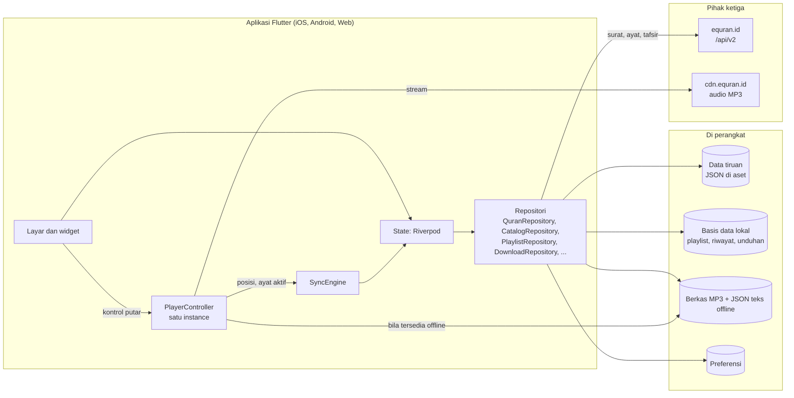

# 02 — Arsitektur

## 1. Stack

Kolom "Status" membedakan yang sudah ada di repositori dari yang masih usulan. Paket usulan belum ditambahkan ke `pubspec.yaml`; versi dipilih saat implementasi.

| Lapisan | Pilihan | Status | Alasan |
|---------|---------|--------|--------|
| Framework | Flutter, Dart `^3.13.5` | **Sudah ada** (`pubspec.yaml`) | Satu basis kode untuk iOS, Android, dan web, sesuai PRD |
| Navigasi | `go_router` | Usulan | Rute deklaratif, tautan dalam (deep link), cocok untuk web |
| State | Riverpod | Usulan (keputusan terbuka #2) | Status pemutar bisa dibaca banyak layar tanpa meneruskan konteks; mudah diuji |
| HTTP | `dio` (atau `http`) | Usulan | Interceptor untuk cache, batas waktu, dan coba ulang |
| Model | Kelas Dart tak-berubah (`freezed` atau tulisan tangan) + `json_serializable` | Usulan | Pemetaan JSON `equran.id` yang eksplisit |
| Audio | `just_audio` + `audio_service` | Usulan | Pemutaran latar belakang, kontrol layar kunci, antrean; dipakai luas |
| Penyimpanan kecil | `shared_preferences` | Usulan | Pengaturan (qari bawaan, ukuran huruf, tema) |
| Penyimpanan terstruktur | Drift (SQLite) atau Hive | Usulan (keputusan terbuka #3) | Playlist, riwayat putar, daftar unduhan |
| Berkas offline | `path_provider` + `dio.download` | Usulan | Simpan MP3 di folder aplikasi |
| Gambar | `cached_network_image` atau aset bundel | Usulan | Artwork tiruan di aset agar cepat dan tidak bergantung jaringan |
| Pemantau jaringan | `connectivity_plus` | Usulan | Banner offline dan keputusan sumber audio |
| Uji | `flutter_test`, `integration_test`, `mocktail` | `flutter_test` + `flutter_lints` **sudah ada** | Uji unit, widget, dan alur |

Folder `test/` diabaikan oleh dokumen ini; strategi uji ada di [09](09-roadmap-and-testing.md#4-strategi-pengujian).

### Mengapa tanpa backend sendiri

- PRD menetapkan fokus pada frontend dan data tiruan.
- Hanya data Al-Qur'an yang membutuhkan jaringan, dan itu tersedia dari `equran.id` tanpa kunci API (diverifikasi 17 Nov 2026).
- Satu pihak ketiga lebih sedikit titik gagal daripada menambah server sendiri.
- Antarmuka repositori ([bagian 3](#3-lapisan-dan-aturan-ketergantungan)) membuat penambahan backend nanti hanya berarti mengganti implementasi repositori.

## 2. Diagram komponen



Poin penting:
- **`PlayerController` hanya satu** dan hidup selama aplikasi hidup (di luar pohon widget layar). Layar hanya membaca statusnya dan mengirim perintah.
- **`SyncEngine` tidak memutar audio.** Ia hanya menerjemahkan posisi audio menjadi "ayat ke-berapa yang aktif".
- Satu-satunya host jaringan yang dipakai: `equran.id` dan `cdn.equran.id`. Aset gambar dan font dibundel (KPI 5).

## 3. Lapisan dan aturan ketergantungan

```
Layar / widget  ──▶  State (provider)  ──▶  Repositori (antarmuka)  ──▶  Sumber data (API / tiruan / lokal)
        ▲                                         ▲
        └──────────  PlayerController  ───────────┘
```

| Lapisan | Boleh bergantung pada | Tidak boleh |
|---------|----------------------|-------------|
| `presentation` (layar, widget) | state, model domain | `dio`, `shared_preferences`, SQL, berkas JSON tiruan secara langsung |
| `application` (provider, controller) | repositori (antarmuka), model domain | widget Flutter |
| `domain` (model, antarmuka repositori) | Dart murni | Flutter, paket jaringan |
| `data` (implementasi repositori, DTO) | `dio`, penyimpanan, aset | widget, state |

Aturan: **layar tidak tahu apakah data berasal dari API, aset tiruan, atau cache.** Ini yang menjaga KPI 5 (pemisahan frontend-first).

### Pasangan repositori dan sumbernya

| Repositori | Isi | Sumber v1 |
|------------|-----|-----------|
| `QuranRepository` | Daftar surat, detail surat + ayat, tafsir, audio | **API `equran.id`** + cache disk |
| `QariRepository` | Daftar qari (nama, foto, bio) | **Tiruan**, dipetakan ke kode qari API ([03](03-api-integration.md#3-pemetaan-qari)) |
| `CatalogRepository` | Nasheed, adhkar, podcast, koleksi | Tiruan |
| `SearchRepository` | Pencarian dan filter | Memakai data repositori lain (di perangkat) |
| `PlaylistRepository` | Playlist pengguna | Tiruan awal + disimpan lokal |
| `RecommendationRepository` | Rekomendasi | Tiruan (aturan sederhana di perangkat) |
| `HistoryRepository` | Riwayat putar, posisi terakhir | Lokal |
| `DownloadRepository` | Status dan berkas unduhan | Lokal + berkas |
| `SettingsRepository` | Qari bawaan, ukuran huruf, tema | Lokal |
| `UserRepository` | Profil tiruan aktif | Tiruan |

## 4. Alur data utama

### 4.1 Memutar surat (jaringan tersedia)

```mermaid
sequenceDiagram
  actor U as Pengguna
  participant UI as Layar
  participant PC as PlayerController
  participant QR as QuranRepository
  participant API as equran.id
  participant A as Mesin audio (just_audio)

  U->>UI: Ketuk "Putar" pada surat 1 (qari 05)
  UI->>PC: playSurah(1, qari: "05")
  PC->>QR: getSurah(1)
  alt ada di cache disk
    QR-->>PC: detail surat dari cache
  else belum ada
    QR->>API: GET /surat/1
    API-->>QR: data surat + audioFull + ayat
    QR-->>PC: detail surat (disimpan ke cache)
  end
  PC->>A: setAudioSource(audioFull["05"])
  A-->>PC: status memuat → siap
  PC-->>UI: status: playing, posisi bergulir
  Note over UI: Player Bar muncul; Reader menyorot ayat lewat SyncEngine
```

### 4.2 Memutar tanpa jaringan

1. `PlayerController` bertanya ke `DownloadRepository` apakah berkas lokal untuk item itu ada.
2. Bila ada, sumber audio adalah **berkas lokal**; bila tidak dan jaringan putus, status menjadi `error(offlineNotDownloaded)` dan UI menampilkan pesan, bukan layar kosong.
3. Teks Al-Qur'an untuk Reader dibaca dari JSON yang ikut disimpan saat unduhan ([08](08-catalog-playlist-offline.md#53-isi-satu-unduhan)).

### 4.3 Pembaruan status pemutar

Status pemutar dialirkan (stream) dari mesin audio ke satu provider; layar memilih potongan yang dibutuhkan (`select`) supaya tidak membangun ulang seluruh layar tiap 200 ms. Posisi pemutaran **tidak** disimpan di provider yang sama dengan status "sedang memutar" (lihat [05 §3](05-audio-player.md#3-status-pemutar)).

## 5. Struktur folder usulan

```
quran_app_final_project/
├─ docs/                          # dokumen ini
├─ assets/
│  ├─ mock/                       # JSON data tiruan (users, qari, nasheed, adhkar, podcast, playlist)
│  ├─ images/                     # artwork tiruan, ilustrasi keadaan kosong
│  ├─ audio_samples/              # contoh audio nasheed/adhkar/podcast (bila diputuskan)
│  └─ fonts/                      # font Arab (Naskh) dan font antarmuka, dibundel
├─ lib/
│  ├─ main.dart                   # titik masuk, ProviderScope
│  ├─ app/                        # MaterialApp, tema, router, konstanta
│  ├─ core/
│  │  ├─ network/                 # klien dio, interceptor cache, pemetaan error
│  │  ├─ storage/                 # basis data lokal, preferensi
│  │  ├─ errors/                  # kelas kegagalan (AppFailure)
│  │  └─ utils/                   # format durasi, format angka Arab, debouncer
│  ├─ features/
│  │  ├─ player/                  # domain, application (PlayerController), presentation (3 tampilan)
│  │  ├─ reader/                  # SyncEngine, layar Reader, lembar tafsir
│  │  ├─ quran/                   # daftar surat, QuranRepository, DTO API
│  │  ├─ catalog/                 # qari, nasheed, adhkar, podcast
│  │  ├─ search/
│  │  ├─ playlist/
│  │  ├─ recommendation/
│  │  ├─ downloads/               # unduhan dan kelola penyimpanan
│  │  ├─ home/
│  │  └─ settings/
│  └─ shared/                     # widget bersama (kartu, baris daftar, keadaan kosong/error)
└─ test/                          # diabaikan di dokumen ini
```

Aturan: satu fitur satu folder, dengan subfolder `domain/`, `data/`, `application/`, `presentation/` bila perlu. Kode lintas fitur masuk `core/` atau `shared/`; fitur tidak mengimpor `presentation/` fitur lain.

## 6. Konfigurasi

| Konstanta | Nilai | Catatan |
|-----------|-------|---------|
| `apiBaseUrl` | `https://equran.id/api/v2` | Jangan memakai `/apidev/v2` dari PRD (404) |
| `connectTimeout` | 10 dtk | Usulan |
| `receiveTimeout` | 20 dtk | Usulan; respons surat panjang (Al-Baqarah) besar |
| `defaultQariId` | `"05"` | Usulan ([01 §8](01-overview.md#8-keputusan-yang-masih-terbuka)) |
| `maxConcurrentDownloads` | 2 | Usulan |

Tidak ada rahasia: API tidak memakai kunci pada percobaan 17 Nov 2026. Jika kelak butuh kunci, **jangan** ditanam di kode aplikasi (mudah diekstrak); gunakan proksi.

## 7. Penanganan error di lapisan aplikasi

- Repositori mengubah semua kegagalan menjadi satu tipe `AppFailure` dengan jenis tetap: `offline`, `timeout`, `notFound`, `server`, `parse`, `storageFull`, `notDownloaded`, `unknown`.
- Layar memetakan jenis itu ke pesan Bahasa Indonesia, misalnya `offline` → "Kamu sedang offline. Konten yang sudah diunduh tetap bisa diputar."
- Pesan teknis (stack trace, kode HTTP mentah) **tidak pernah** ditampilkan; cukup dicatat di log debug.
- Kegagalan memuat daftar tidak mengosongkan data lama yang sudah tampil: tampilkan data cache dengan banner "Menampilkan data tersimpan".
- Panggilan jaringan bersifat `GET` dan aman diulang; coba ulang otomatis maksimal 2 kali dengan jeda naik untuk `timeout` dan `5xx`.
- Kegagalan pemutaran (berkas 404, putus di tengah) menghentikan item itu, menampilkan pesan, dan **melompat ke item berikutnya hanya bila pengguna menyalakannya**; bawaannya berhenti.

## 8. Keamanan dan privasi

Frontend-only, tetapi tetap ada pertimbangan:

- **HTTPS saja.** Semua host `https`. Aplikasi Android tidak mengaktifkan `usesCleartextTraffic`.
- **Tidak ada data pribadi nyata.** Profil tiruan hanya nama dan avatar fiktif. Jangan meminta email atau nomor telepon di UI demo.
- **Data lokal** (riwayat, playlist) hanya di perangkat; tidak dikirim ke mana pun. Tulis ini di halaman Pengaturan > Privasi.
- **Teks dari API ditampilkan sebagai teks.** Field `deskripsi` berisi tag HTML (`<i>`, `<br>`; diverifikasi). Jangan dirender sebagai HTML mentah di web; ubah tag yang diketahui menjadi gaya teks dan buang sisanya.
- **Pembatasan permintaan.** Jangan memuat 114 surat berantai saat memulai; ambil daftar (satu permintaan) dan surat bila dibuka. Ini sopan terhadap layanan gratis dan menjaga KPI 1.

## 9. Keputusan arsitektur (ringkas)

| Keputusan | Alternatif | Alasan memilih |
|-----------|------------|----------------|
| Satu `PlayerController` di luar pohon widget | Pemutar per layar | Pemutaran tidak boleh terputus saat berpindah layar; status tunggal mencegah tiga tampilan pemutar saling tidak cocok |
| Repositori dengan antarmuka per sumber data | Layar memanggil API langsung | Menjamin pemisahan data tiruan, membuat uji mudah, dan backend baru nanti tidak mengubah layar |
| Mode sinkronisasi ganda (per ayat nyata, surat penuh tiruan) | Hanya waktu tiruan; mencari data waktu ayat dari sumber lain | API menyediakan audio per ayat sehingga sinkronisasi nyata tersedia tanpa data tambahan; waktu tiruan hanya untuk audio surat penuh, sesuai PRD |
| Teks Al-Qur'an tidak diolah | Merapikan atau memotong teks | Kebenaran teks suci lebih penting daripada kerapian |
| Data tiruan sebagai JSON di aset | Data tiruan di kode Dart | Mudah diubah desainer/PM tanpa menyentuh kode, dan bentuknya meniru respons backend nyata |
| Cache surat di disk, bukan hanya memori | Hanya memori | Respons surat besar; offline dan KPI kecepatan butuh cache tahan restart |
| Aset (gambar, font) dibundel | Memuat dari jaringan | Menjaga satu-satunya host luar adalah `equran.id` dan mempercepat tampilan pertama |
