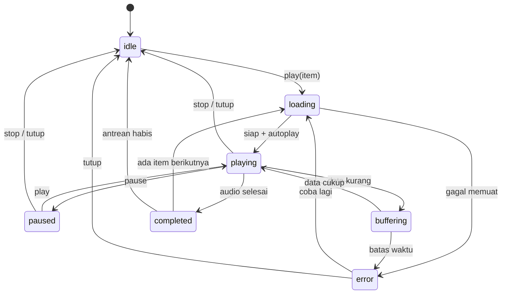

# 05 — Pemutar Audio (Fase 1)

Pemutar adalah inti produk. Dokumen ini menetapkan perilaku; tampilan visual rinci ada di [07](07-ui-ux.md) dan berkas desain dari UI/UX Designer. Pola kontrol mengikuti kebiasaan pemutar Spotify (asumsi PRD), tanpa menyalin aset atau teksnya.

## 1. Tiga tampilan, satu pemutar

Ketiga komponen hanya **tampilan** dari satu `PlayerController`. Mengetuk dari satu tampilan ke tampilan lain tidak menghentikan atau memuat ulang audio.

| Komponen | Di mana | Isi | Cara masuk/keluar |
|----------|---------|-----|-------------------|
| **Mini Player** | Ponsel: melayang tepat di atas bilah navigasi bawah, selebar layar dikurangi jarak | Artwork kecil, judul + subjudul (berjalan bila panjang), tombol putar/jeda, tombol berikutnya, garis progres tipis di tepi bawah | Muncul begitu ada item aktif. Ketuk badan → Fullscreen. Geser ke bawah/tombol tutup → menghentikan dan menghapus antrean (dengan batalkan) |
| **Player Bar** | Tablet dan web lebar (≥ 840 dp): bilah tetap di dasar halaman | Artwork, judul, kontrol lengkap (acak, sebelumnya, putar/jeda, berikutnya, ulang), bilah geser dengan waktu, volume, tombol antrean, tombol perluas | Selalu ada bila ada item aktif. Tombol perluas → Fullscreen |
| **Fullscreen Player** | Semua ukuran | Artwork besar, judul, subjudul (dapat diketuk ke detail qari/acara), bilah geser + waktu, kontrol lengkap, kecepatan, timer tidur, tombol Baca (membuka Reader untuk surat), antrean, tambah ke playlist, unduh | Naik dari Mini Player/Player Bar dengan animasi bersama (artwork *hero*); turun dengan geser ke bawah atau tombol tutup |

> **Perlu dikonfirmasi desainer:** apakah di ponsel Mini Player dan Player Bar dianggap dua tampilan berbeda (seperti di atas) atau satu bilah adaptif. Dari sisi kode, keduanya memakai provider yang sama, jadi keputusan ini tidak mengubah arsitektur.

Tidak boleh ada dua pemutar aktif sekaligus; memutar item baru menggantikan item yang berjalan.

## 2. Jenis konten yang diputar

Semua dibungkus `MediaItem` ([04 §3](04-mock-data.md#3-model-media-tunggal)).

| Jenis | Sumber audio | Durasi | Catatan |
|-------|--------------|--------|---------|
| `surah` | `audioFull[qariId]` dari API | Diketahui setelah audio dimuat (API tidak memberi durasi) | Item utama; punya Reader |
| `ayah` | `ayat[n].audio[qariId]` dari API | Idem | Dipakai mode per ayat di Reader dan "ulangi ayat" |
| `nasheed`, `adhkar`, `podcastEpisode` | Aset tiruan | Dari data tiruan | Tanpa Reader |

**Durasi surat tidak ada di API** (diverifikasi: `/surat` tidak memuat field durasi). Tampilan sebelum audio dimuat menampilkan `--:--`, bukan 00:00 atau perkiraan palsu. Setelah dimuat, durasi dari mesin audio dipakai dan disimpan ke cache metadata supaya daftar berikutnya bisa menampilkannya.

## 3. Status pemutar

### 3.1 Mesin status



### 3.2 Bentuk status (usulan)

```dart
class PlayerState {
  final PlayerPhase phase;         // idle, loading, playing, paused, buffering, completed, error
  final MediaItem? current;
  final List<MediaItem> queue;
  final int currentIndex;
  final RepeatMode repeat;         // off, all, one
  final bool shuffle;
  final double speed;              // 0.5 .. 2.0
  final PlayerError? error;
  final DateTime? sleepAt;         // timer tidur
}
```

**Posisi dan buffer tidak di dalam `PlayerState`.** Keduanya berubah beberapa kali per detik; menaruhnya di status utama akan membangun ulang seluruh tampilan. Posisi dialirkan lewat stream/provider terpisah yang hanya dibaca oleh bilah geser, teks waktu, dan `SyncEngine`.

## 4. Perintah

| Perintah | Perilaku |
|----------|----------|
| `play(item, {queue})` | Mengganti item aktif; bila `queue` diberikan, jadi antrean dan `currentIndex` dihitung |
| `pause()` / `resume()` / `toggle()` | Idempoten |
| `seek(position)` | Posisi dijepit antara 0 dan durasi; saat `buffering`, ditunda sampai siap |
| `next()` | Item berikutnya; di ujung antrean dengan `repeat=off` → berhenti ke `completed` |
| `previous()` | Bila posisi > 3 detik: kembali ke awal item; bila ≤ 3 detik: item sebelumnya |
| `skip(±15s)` | Hanya untuk `podcastEpisode` dan `adhkar` panjang; tombol tidak tampil untuk surat (lompat ayat dipakai) |
| `setSpeed(x)` | 0,75 / 1 / 1,25 / 1,5 / 2 (usulan); bertahan antarsesi per jenis konten |
| `setShuffle`, `setRepeat` | `off → all → one` bergilir |
| `setSleepTimer(d)` | 5, 10, 15, 30, 45, 60 menit atau "akhir item"; memudar volume 5 detik sebelum berhenti |
| `enqueue(item)` / `playNext(item)` | Tambah di akhir / langsung sesudah item aktif |
| `removeFromQueue`, `reorderQueue` | Hanya mengubah antrean; item aktif yang dihapus → lanjut ke berikutnya |
| `stop()` | Kembali `idle`, antrean dikosongkan |

Perintah yang tidak berlaku pada keadaan itu (mis. `next` saat `idle`) diabaikan tanpa error.

## 5. Antrean

- **Dari mana antrean dibentuk:** daftar surat (urutan surat dari yang diketuk ke surat 114), halaman qari, playlist, album, episode podcast. Sumbernya dicatat (`queueSource`) agar judul antrean di Fullscreen bermakna ("Memutar dari Playlist Pagi").
- **Acak:** mengacak urutan sisa tanpa mengulang item yang sudah diputar pada putaran ini; mematikan acak mengembalikan urutan asli di sekitar item aktif.
- **Ulang:** `all` mengulang antrean; `one` mengulang item aktif.
- **Batas:** antrean maksimum 500 item (usulan); lebih dari itu dipotong dengan pesan.
- **Antrean bertahan** saat aplikasi ditutup dan dibuka lagi: item aktif + posisi terakhir dipulihkan dalam keadaan **jeda**, tidak otomatis berbunyi.

## 6. Pemutaran latar belakang dan sistem

| Situasi | Perilaku |
|---------|----------|
| Aplikasi ke latar belakang / layar terkunci | Pemutaran lanjut; kontrol dan metadata (judul, subjudul, artwork) tampil di layar kunci/notifikasi (`audio_service`) |
| Panggilan masuk atau aplikasi lain meminta fokus audio | Jeda; lanjut otomatis hanya bila gangguan pendek (perilaku standar sistem) |
| Headset dicabut / Bluetooth terputus | Jeda |
| Tombol media headset | Putar/jeda, berikutnya, sebelumnya |
| Jaringan putus saat streaming | `buffering`; setelah batas waktu 20 detik → `error` dengan pesan dan tombol "Coba lagi"; bila item terunduh, otomatis beralih ke berkas lokal bila tersedia |
| Web | Pemutaran jalan selama tab hidup; Media Session API diisi untuk tombol media; **tidak ada jaminan di tab latar pada semua browser** |

Catatan platform yang perlu diuji, bukan diasumsikan: iOS memerlukan konfigurasi mode latar belakang audio; Android 13+ memerlukan izin notifikasi untuk notifikasi media; Safari iOS membatasi pemutaran otomatis (harus dari ketukan pengguna).

## 7. Sumber audio: pilih yang terbaik yang tersedia

Urutan keputusan saat memuat item:

1. Ada **berkas unduhan** lengkap → pakai berkas lokal.
2. Ada jaringan → **stream** dari URL di respons API (atau aset tiruan).
3. Tidak ada jaringan dan tidak terunduh → `error(notDownloaded)`: "Belum diunduh. Hubungkan internet atau unduh dulu."

Penjelasan ke pengguna jelas: ikon sumber kecil (awan = stream, panah bawah = lokal) di Fullscreen.

## 8. Animasi dan kinerja (KPI 3: 60 fps)

Anggaran bingkai: **16,6 ms** per bingkai pada perangkat kelas menengah.

| Aturan | Alasan |
|--------|--------|
| Pembaruan posisi untuk UI maksimal ±10 Hz (tiap 100 ms), tidak lebih sering | Bilah geser terlihat mulus tanpa membangun ulang berlebihan |
| Bilah progres dan teks waktu adalah widget kecil terpisah yang mendengarkan stream posisi; widget lain tidak | Membatasi area yang dibangun ulang |
| Bungkus artwork, bilah geser, dan visualisasi dengan `RepaintBoundary` | Menjaga animasi tidak memicu gambar ulang tetangga |
| Transisi Mini Player ↔ Fullscreen: ±300 ms, kurva *ease-out*, artwork berpindah dengan animasi bersama (*hero*) | Terasa kontinu |
| Judul panjang berjalan (marquee) hanya saat tampil dan tidak sedang transisi | Hemat render |
| Gambar artwork didekode pada ukuran tampil (`cacheWidth`) | Mengurangi memori dan jank |
| Tidak ada pekerjaan berat (parsing JSON besar, hitung waktu ayat) di isolate UI saat pemutar bergerak | Parsing Al-Baqarah (±397 KB) dilakukan di isolate terpisah |
| Hormati "kurangi gerakan" sistem: matikan *marquee* dan animasi besar | Aksesibilitas |

Pengukuran: Flutter DevTools *Performance*, mode **profile**, perangkat nyata (bukan emulator). Lihat [09 §3.3](09-roadmap-and-testing.md#33-kpi-3--kelancaran-60-fps).

## 9. Aksesibilitas pemutar

- Semua tombol punya label (`Semantics`): "Putar", "Jeda", "Berikutnya", "Sebelumnya", "Acak, aktif", "Ulang semua".
- Area sentuh minimal 48 × 48 dp, termasuk tombol di Mini Player.
- Bilah geser dapat digerakkan dengan pembaca layar (naik/turun menggeser 5 detik) dan mengumumkan "1 menit 20 detik dari 4 menit".
- Perubahan status penting (mulai, jeda, error) diumumkan ke pembaca layar secara tidak mengganggu.
- Tidak mengandalkan warna saja untuk status (aktif/nonaktif acak dan ulang memakai bentuk/penanda selain warna).

## 10. Keadaan khusus

| Keadaan | Perilaku |
|---------|----------|
| Item tanpa durasi (surat sebelum dimuat) | Tampilkan `--:--`, bilah geser nonaktif sampai siap |
| Berkas gagal 404 | `error`; tombol "Coba lagi" dan "Lewati" |
| Pengguna memutar item yang sama yang sedang aktif | Buka Fullscreen; tidak mengulang dari awal |
| Volume sistem 0 | Tampilkan petunjuk kecil "Volume perangkat 0" sekali per sesi |
| Antrean kosong setelah hapus | Kembali `idle`, bilah menghilang |
| Offline, item berikutnya tidak terunduh | Lewati ke item terunduh berikutnya dengan toast, atau berhenti bila tidak ada |

## 11. Kriteria selesai (Fase 1)

1. Memutar, jeda, seek, berikutnya, sebelumnya, acak, ulang berfungsi untuk surat (API) dan satu jenis konten tiruan.
2. Tiga tampilan sinkron: menggeser bilah geser di Fullscreen langsung terlihat di bilah ringkas, tanpa jeda audio.
3. Berpindah antarlayar (Beranda → Katalog → Reader) tidak mengganggu pemutaran.
4. Pemutaran lanjut di latar belakang dan layar kunci di Android dan iOS (diuji di perangkat nyata).
5. Animasi Mini Player ↔ Fullscreen terukur ≥ 55 fps rata-rata dan tanpa bingkai > 32 ms berurutan di perangkat uji.
6. Keadaan error (offline, 404) menampilkan pesan Bahasa Indonesia dan jalan keluar.
