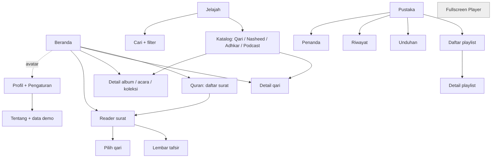

# 07 — UI dan UX

Dokumen ini adalah **acuan struktur** untuk desainer dan developer: layar apa saja, bagaimana berpindah, komponen apa yang dipakai ulang, dan keadaan apa yang wajib dirancang. Rupa visual (warna, tipografi, ilustrasi, ikon) adalah wewenang UI/UX Designer dan akan dicatat di berkas desain; sampai ada, nilai di sini bersifat usulan.

> **Catatan acuan.** PRD menyebut MuslyWave sebagai inspirasi dan Spotify sebagai pola kontrol yang dikenal pengguna. Dokumen ini **belum** memuat hasil pengamatan langsung terhadap MuslyWave; hanya pola umum pemutar streaming. Tambahkan pengamatan bila desainer sudah menelaahnya, dan jangan menyalin nama, logo, aset, atau teks mereka.

Prinsip: **mobile-first** (ponsel lebih dulu, 70–80 % pengguna), **satu tangan**, **jempol-menjangkau** (aksi utama di bawah), dan **teks Arab selalu terbaca**.

## 0. Kerangka layar bersama

### 0.1 Titik patah (*breakpoint*)

| Kelas | Lebar | Perangkat khas | Navigasi | Pemutar |
|-------|-------|----------------|----------|---------|
| Compact | < 600 dp | Ponsel | Bilah navigasi bawah (4 tab) | Mini Player di atas bilah navigasi |
| Medium | 600–839 dp | Ponsel besar landscape, tablet kecil | Rel navigasi di kiri | Mini Player di dasar isi |
| Expanded | ≥ 840 dp | Tablet, web desktop | Sidebar kiri tetap | **Player Bar** lebar di dasar |

Isi dibatasi lebar maksimum ±1.200 dp di web agar baris teks tidak terlalu panjang; Reader dibatasi ±720 dp di tengah.

### 0.2 Cangkang aplikasi (`AppShell`)

```
COMPACT (ponsel)                            EXPANDED (web/tablet)
┌────────────────────────────┐              ┌─────────┬──────────────────────────────┐
│  Judul halaman     [avatar]│              │ ◉ Logo  │  Judul halaman     [avatar]  │
│                            │              │         │                              │
│  isi (menggulir)           │              │ Beranda │  isi (menggulir)             │
│                            │              │ Quran   │                              │
│                            │              │ Jelajah │                              │
│ ┌ Mini Player ───────────┐ │              │ Pustaka │                              │
│ └────────────────────────┘ │              ├─────────┴──────────────────────────────┤
│ [Beranda][Quran][Jelajah][Pustaka]        │ Player Bar: artwork · kontrol · bilah geser · volume │
└────────────────────────────┘              └────────────────────────────────────────┘
```

- Isi aplikasi berada **di dalam** cangkang; Fullscreen Player menutup cangkang (rute modal).
- Pada web, URL mencerminkan layar (lihat §1.2) sehingga tombol kembali dan segarkan halaman bekerja.

### 0.3 Pola kepala halaman

1. **Judul** besar (± 28 sp), subjudul satu kalimat redup bila perlu.
2. Di kanan: aksi utama halaman (cari, pengaturan) atau chip penghitung ("12 playlist").
3. Pada layar yang menggulir panjang, kepala mengecil menjadi bilah atas (sliver) saat digulir.

### 0.4 Komponen berulang

| Komponen | Bentuk | Dipakai di |
|----------|--------|-----------|
| **Kartu media** | Artwork persegi, judul 1–2 baris, subjudul redup; ketuk = buka detail, tombol putar di sudut | Rak Beranda, Katalog |
| **Baris media** | Artwork kecil, judul + subjudul, durasi/status di kanan, menu `⋯` | Daftar lagu, antrean, playlist, hasil cari |
| **Baris surat** | Nomor dalam ornamen, nama Latin + arti, nama Arab di kanan, jumlah ayat, tombol putar | Daftar surat |
| **Rak** | Judul rak + "Lihat semua" + baris kartu menggulir mendatar | Beranda, Jelajah |
| **Chip penyaring** | Kapsul dapat dipilih; bisa banyak | Katalog, Cari |
| **Lencana** | Kapsul kecil: "Vocal-only", "Terunduh", "Demo" | Kartu dan baris |
| **Bilah geser (seek)** | Trek tipis, pegangan membesar saat disentuh, waktu di kiri-kanan | Fullscreen, Player Bar |
| **Lembar bawah (bottom sheet)** | Menu aksi, pilih qari, kecepatan, timer tidur, tafsir | Banyak tempat |
| **Mini Player** | [05 §1](05-audio-player.md#1-tiga-tampilan-satu-pemutar) | Semua layar |
| **Skeleton** | Kerangka abu bergerak halus untuk daftar yang sedang dimuat | Semua daftar |
| **Banner status** | "Kamu sedang offline", "Menampilkan data tersimpan" | Atas isi |
| **Keadaan kosong/error** | Ilustrasi + judul + satu kalimat + tombol | Semua daftar |

## 1. Peta layar

### 1.1 Diagram



Fullscreen Player dapat dibuka dari semua layar (Mini Player atau Player Bar).

### 1.2 Rute (usulan)

| Rute | Layar |
|------|-------|
| `/` | Beranda |
| `/quran` | Daftar surat |
| `/quran/:surat` (+ `?ayat=N`) | Reader |
| `/jelajah` | Jelajah (katalog, rak) |
| `/jelajah/:jenis` | Katalog `qari`, `nasheed`, `adhkar`, `podcast` |
| `/qari/:id`, `/podcast/:id`, `/album/:id`, `/koleksi/:id` | Detail |
| `/cari?q=…&jenis=…` | Pencarian |
| `/pustaka` | Pustaka (tab: playlist, unduhan, riwayat, penanda) |
| `/pustaka/playlist/:id` | Detail playlist |
| `/pengaturan`, `/tentang` | Pengaturan, Tentang |
| `/putar` | Fullscreen Player (rute modal) |

Rute tidak dikenal → layar "Halaman tidak ditemukan" dengan tombol ke Beranda. Pada web, `/quran/:surat` dengan nomor di luar 1–114 → layar itu, bukan error.

## 2. Layar

### 2.1 Beranda

| Bagian | Isi |
|--------|-----|
| Sapaan | "Assalamu'alaikum, {nama}" (profil tiruan) atau "Selamat datang" untuk tamu |
| Lanjutkan mendengarkan | Satu kartu lebar: item terakhir + posisi + tombol lanjut. Disembunyikan bila belum ada riwayat |
| Rak "Untuk kamu" | Rekomendasi ([08 §6](08-catalog-playlist-offline.md#6-rekomendasi)) |
| Rak "Surat populer" | Daftar surat pilihan editorial (tiruan, mis. Yasin, Al-Kahfi, Ar-Rahman, Al-Mulk) |
| Rak "Qari" | Kartu enam qari |
| Rak "Nasheed", "Adhkar pagi", "Podcast" | Dari koleksi tiruan |

Beranda **tidak menunggu** API untuk tampil: bagian yang dari tiruan muncul langsung; bagian surat muncul saat daftar surat siap (skeleton sebelum itu).

### 2.2 Quran dan Reader

Rinci di [06](06-quran-reader.md). Ringkas: daftar 114 surat dengan pencarian dan penyaring; Reader dengan dua mode, sorotan ayat, pengaturan tampilan.

### 2.3 Jelajah dan Katalog

| Bagian | Isi |
|--------|-----|
| Bilah cari | Kolom pencarian di atas; mengetuk membuka layar Cari dengan papan ketik |
| Segmen jenis | Qari · Nasheed · Adhkar · Podcast (tab atau chip) |
| Isi | Kisi kartu (compact: 2 kolom, medium: 3–4, expanded: 5–6) dengan penyaring |
| Detail qari | Foto, bio, "Putar semua", daftar surat yang tersedia untuk qari itu (114) |
| Detail album/acara | Artwork besar, deskripsi, daftar item, tombol putar/acak/unduh |

Rincian filter dan alur di [08](08-catalog-playlist-offline.md).

### 2.4 Cari

- Kolom cari dengan jeda ketik (*debounce*) ±250 ms; hasil dari data di perangkat (tidak memanggil API).
- Hasil dikelompokkan: Surat · Qari · Nasheed · Adhkar · Podcast.
- Riwayat pencarian terakhir (lokal) dan saran saat kosong.
- Keadaan tanpa hasil: "Tidak ada hasil untuk '…'" + saran periksa ejaan + jalan pintas ke Katalog.

### 2.5 Pustaka

Tab: **Playlist**, **Unduhan**, **Riwayat**, **Penanda**. Playlist: daftar + tombol "Playlist baru". Unduhan: daftar terunduh + ukuran total + tombol kelola penyimpanan. Riwayat: dikelompokkan per hari. Penanda: daftar ayat tersimpan, ketuk → Reader di ayat itu.

### 2.6 Fullscreen Player

Lihat [05 §1](05-audio-player.md#1-tiga-tampilan-satu-pemutar). Area atas: tombol turun + nama sumber antrean. Tengah: artwork besar. Bawah: judul, bilah geser, kontrol, baris aksi (kecepatan, timer tidur, Baca, antrean, tambah ke playlist, unduh).

### 2.7 Profil dan Pengaturan

| Kelompok | Pengaturan |
|----------|-----------|
| Profil | Masuk sebagai profil demo / keluar (tamu) |
| Pemutaran | Qari bawaan, mode sinkronisasi bawaan, kecepatan bawaan |
| Tampilan | Tema (sistem/terang/gelap), ukuran huruf Arab, tampilkan transliterasi |
| Unduhan | Hanya Wi‑Fi (bawaan: ya), kualitas/kebijakan penyimpanan, hapus semua |
| Privasi | Hapus riwayat, hapus data lokal |
| Tentang | Versi, sumber data, atribusi `equran.id`, catatan data demo |

### 2.8 Tentang dan data demo

Wajib menyebut: data Al-Qur'an dari `equran.id`; konten lain demo; aplikasi tidak berafiliasi dengan MuslyWave atau Spotify.

## 3. Navigasi

- **Empat tab utama:** Beranda, Quran, Jelajah, Pustaka. Pengaturan lewat avatar.
- Tab menyimpan tumpukan rutenya sendiri (kembali ke tab mengembalikan posisi gulir).
- Tombol kembali sistem (Android) menutup Fullscreen Player lebih dulu, lalu berjalan mundur.
- Mengetuk tab yang sedang aktif menggulir ke atas.
- Dari pemutar ke Reader: tombol "Baca" di Fullscreen menuju `/quran/:surat?ayat=aktif`.

## 4. Keadaan UI yang wajib dirancang

Setiap layar daftar harus memiliki keenam keadaan ini; desainer menyediakan komponennya, developer tidak boleh menambahkan keadaan baru tanpa desain.

| Keadaan | Tampilan |
|---------|----------|
| Memuat | Skeleton dengan bentuk yang sama dengan isi (bukan spinner di tengah) |
| Berisi | Normal |
| Kosong | Ilustrasi + kalimat ajakan ("Belum ada playlist. Buat yang pertama.") |
| Galat | Ilustrasi + pesan ramah + "Coba lagi" |
| Offline | Banner di atas; konten non-unduhan redup dengan ikon awan-coret; ketuk → penjelasan |
| Data lama (*stale*) | Banner "Menampilkan data tersimpan" saat gagal memperbarui |

Keadaan khusus pemutar ada di [05 §10](05-audio-player.md#10-keadaan-khusus).

## 5. Teks antarmuka (usulan)

Bahasa Indonesia, nada ramah dan tenang, tanpa tanda seru berlebihan. Kalimat error menyebut **apa yang terjadi** dan **apa yang bisa dilakukan**.

| Situasi | Teks |
|---------|------|
| Offline | "Kamu sedang offline. Konten yang sudah diunduh tetap bisa diputar." |
| Gagal memuat | "Tidak bisa memuat daftar surat. Periksa koneksi, lalu coba lagi." |
| Belum diunduh saat offline | "Belum diunduh. Hubungkan internet atau unduh dulu." |
| Kosong playlist | "Belum ada playlist. Buat yang pertama untuk mengumpulkan bacaan favoritmu." |
| Sorotan perkiraan | "Sorotan perkiraan" |
| Penyimpanan penuh | "Penyimpanan perangkat penuh. Hapus beberapa unduhan lalu coba lagi." |
| Berhasil tambah | "Ditambahkan ke {nama playlist}" (toast dengan "Urungkan") |

Aksi yang bisa dibatalkan (hapus playlist, hapus dari antrean, hentikan pemutar) memakai **toast dengan "Urungkan"**, bukan dialog konfirmasi; dialog hanya untuk yang tak bisa dibalik (hapus semua unduhan, hapus data lokal).

## 6. Responsivitas

| Aspek | Aturan |
|-------|--------|
| Kisi | Kolom ditentukan lebar, bukan jenis perangkat; kartu punya lebar minimum 140 dp |
| Orientasi | Landscape ponsel memakai kelas Medium (rel navigasi); Fullscreen Player menaruh artwork di kiri, kontrol di kanan |
| Skala teks | Antarmuka tahan 200 % tanpa terpotong; teks Arab punya pengaturan terpisah |
| Area aman | Hormati *notch*, bilah gestur, dan dinamis; bilah navigasi bawah tidak tertutup |
| Papan ketik | Layar Cari dan pembuatan playlist tidak tertutup papan ketik; isi menggulir |
| Web | Mendukung mouse (hover, klik kanan menu bila ada), papan ketik (Tab, Enter, Spasi untuk putar/jeda, panah untuk seek), dan perubahan ukuran jendela langsung |
| Layar sangat sempit (< 320 dp) | Tidak ada elemen terpotong; kontrol sekunder pindah ke menu `⋯` |
| Layar lebar (> 1.200 dp) | Isi di tengah dengan lebar maksimum; sidebar dan Player Bar tetap |

Matriks pengujian ada di [09 §4.3](09-roadmap-and-testing.md#43-matriks-responsivitas).

## 7. Tema dan visual (menunggu desainer)

- Tema terang dan gelap mengikuti sistem, dengan pilihan manual.
- Token desain (warna, spasi, radius, tipografi) didefinisikan **sekali** di `app/theme` dan dipakai di seluruh widget; tidak ada warna mentah di widget.
- Tipografi: satu keluarga huruf antarmuka dan satu font Arab (Naskh) yang diuji penuh terhadap tanda baca ([06 §3.4](06-quran-reader.md#34-font-arab)).
- Artwork tiruan dibuat sendiri/berlisensi, rasio 1:1; wajah manusia nyata hanya dengan izin.
- Palet kandidat: nuansa hijau/emas tenang yang lazim untuk konten Islami (usulan, bukan keputusan). Keputusan di tangan desainer.

## 8. Aksesibilitas (daftar periksa)

| # | Syarat |
|---|--------|
| 1 | Kontras teks ≥ 4,5 : 1 (3 : 1 untuk teks besar dan ikon) di kedua tema |
| 2 | Area sentuh ≥ 48 × 48 dp |
| 3 | Semua kontrol punya label untuk pembaca layar; gambar dekoratif ditandai sebagai dekoratif |
| 4 | Urutan fokus logis; fokus terlihat jelas di web (cincin fokus) |
| 5 | Tidak mengandalkan warna saja untuk status (sorotan ayat, acak aktif, error) |
| 6 | Skala teks sampai 200 % |
| 7 | Hormati "kurangi gerakan" (matikan marquee, animasi besar, auto-scroll animasi) |
| 8 | Bilah geser bisa dioperasikan dengan pembaca layar dan papan ketik |
| 9 | Teks Arab diberi bahasa `ar` dan arah RTL; terjemahan `id` |
| 10 | Notifikasi toast dapat dibaca pembaca layar (`liveRegion`) dan bertahan cukup lama (≥ 5 detik) |

## 9. Prinsip kinerja UI (menuju KPI 1)

Rincian pengukuran di [09 §3](09-roadmap-and-testing.md#3-mengukur-kpi). Aturan rancangan:

- Layar pertama (Beranda) harus bisa digambar **tanpa menunggu jaringan**: bagian tiruan dan skeleton tampil dulu.
- Hindari gambar besar di atas lipatan; artwork tiruan dikompres dan dengan dimensi pas.
- Font dibundel dan **disubset** (Arab + Latin yang dipakai) agar kecil; muat font Arab penuh hanya saat Reader dibuka bila perlu.
- Fitur berat (Reader, unduhan, tafsir) dimuat tertunda (*deferred*) pada web.
- Tidak ada animasi pembuka panjang; tampilan pertama tidak menunggu animasi.
