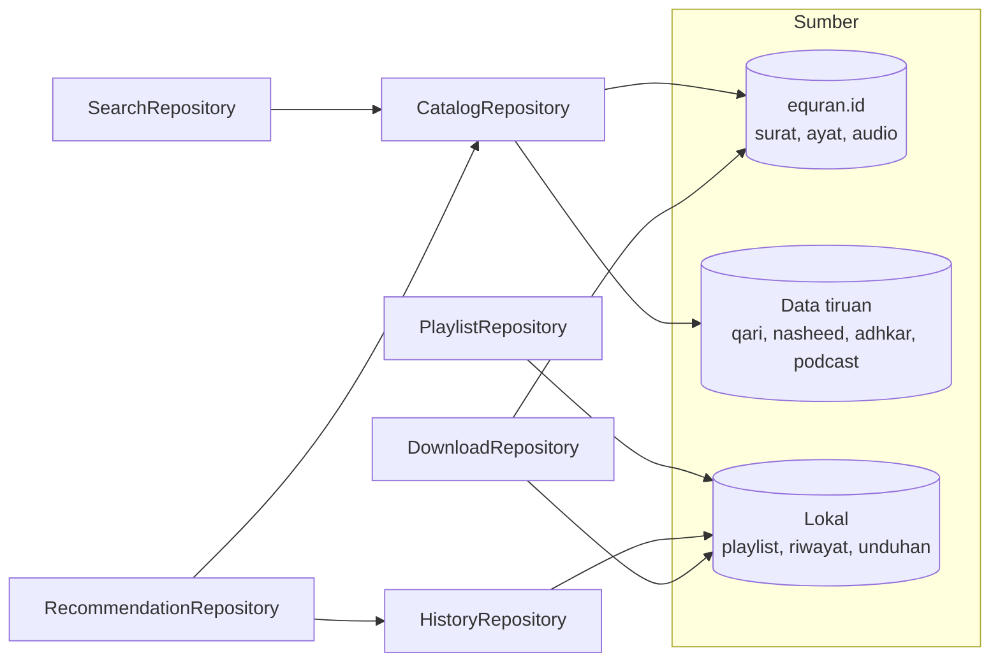
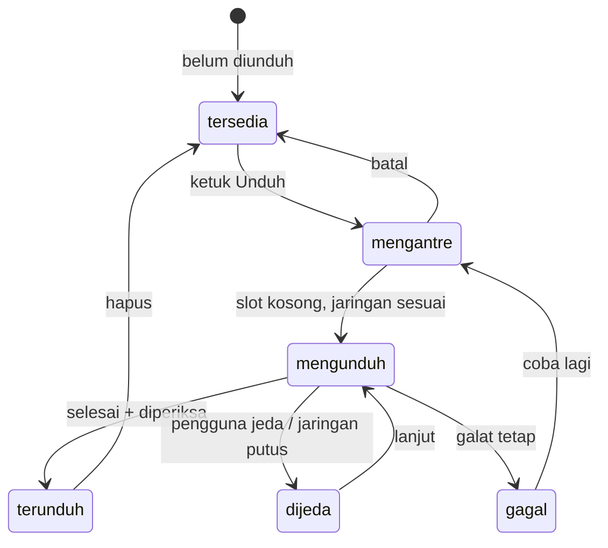

# 08 — Katalog, Playlist, Rekomendasi, dan Offline (Fase 3 dan 4)

Fase 3 membangun penjelajahan: katalog, pencarian, filter, dan playlist. Fase 4 menambahkan rekomendasi dan penyimpanan offline. Semuanya, kecuali teks dan audio Al-Qur'an, bersumber dari data tiruan ([04](04-mock-data.md)) dan penyimpanan lokal.

## 1. Gambaran



## 2. Katalog

### 2.1 Jenis katalog

| Jenis | Isi | Sumber | Detail membuka |
|-------|-----|--------|----------------|
| **Qari** | 6 qari | Tiruan (profil) + API (audio) | Profil qari + daftar 114 surat dengan qari itu |
| **Nasheed** | Lagu a cappella, dikelompokkan per pelantun dan album | Tiruan | Album/pelantun |
| **Adhkar** | Dzikir per kategori (pagi, petang, dll.) | Tiruan | Daftar adhkar kategori |
| **Podcast** | Acara dan episode | Tiruan | Acara + daftar episode |

Surat Al-Qur'an adalah bagian dari tab **Quran**, bukan katalog; pada halaman qari, daftar surat memakai data yang sama dengan tab Quran.

### 2.2 Tata letak

- **Halaman Jelajah:** bilah cari, segmen jenis, rak editorial (koleksi tiruan), dan rak "Baru ditambahkan".
- **Halaman jenis:** kisi kartu dengan chip penyaring dan menu urutan. Pagination: seluruh data tiruan dimuat sekali (puluhan item); daftar dibangun malas.
- **Detail:** kepala dengan artwork, judul, metadata, tombol **Putar**, **Acak**, **Unduh**, **Tambah ke playlist**; di bawahnya daftar item. Item yang sedang diputar ditandai.

### 2.3 Urutan

| Jenis | Urutan yang tersedia | Bawaan |
|-------|----------------------|--------|
| Qari | Abjad, kode API | Abjad |
| Nasheed | Terbaru, abjad, durasi | Terbaru |
| Adhkar | Urutan kategori, durasi | Urutan kategori |
| Podcast | Terbaru, abjad | Terbaru |

## 3. Pencarian dan filter

### 3.1 Cakupan

Yang dicari: **surat** (dari daftar API yang sudah di-cache), qari, nasheed, adhkar, podcast dan episode. Pencarian berjalan **di perangkat** terhadap data yang sudah dimuat; tidak ada panggilan API khusus. Tidak ada pencarian isi ayat pada versi 1 (butuh memuat 114 surat; di luar cakupan).

### 3.2 Normalisasi teks

Agar pencarian toleran:

| Aturan | Contoh |
|--------|--------|
| Huruf kecil | `AL-BAQARAH` = `al-baqarah` |
| Hapus tanda hubung, apostrof, dan spasi ganda | `Al Baqarah` = `Al-Baqarah` |
| Hapus awalan "Al-", "An-", "As-", dst. untuk pencocokan tambahan | `baqarah` menemukan `Al-Baqarah` |
| Hapus diakritik Latin | `Faatihah` ≈ `Fatihah` (sebatas yang disepakati; transliterasi bervariasi) |
| Nomor | `2` atau `surat 2` menemukan Al-Baqarah |
| Teks Arab | Buang harakat dan tanda baca saat membandingkan nama Arab (`nama`) |

Pencocokan: awalan lebih diutamakan daripada kemunculan di tengah; hasil diurutkan menurut skor sederhana (cocok persis > awalan > mengandung).

Kekurangan yang diterima: transliterasi nama surat tidak seragam (mis. "Al-Fatihah" vs "Al-Faatihah"); pencarian akan melewatkan sebagian ejaan alternatif. Dokumentasikan di uji.

### 3.3 Filter per jenis

| Jenis | Filter |
|-------|--------|
| Surat | Tempat turun (Mekah / Madinah), rentang jumlah ayat (pendek ≤ 20 / sedang / panjang ≥ 100 — usulan) |
| Qari | Negara, gaya bacaan (tag) |
| Nasheed | Pelantun, tag suasana (mis. tenang, anak), durasi, bahasa |
| Adhkar | Kategori |
| Podcast | Kategori, durasi episode |
| Semua | "Hanya vocal-only", "Hanya terunduh" |

Aturan filter:

- Beberapa nilai dalam satu filter = **ATAU**; antarfilter = **DAN**.
- Filter aktif tampil sebagai chip yang dapat dihapus satu-satu, ditambah tombol "Hapus semua".
- Jumlah hasil tampil ("12 hasil"). Hasil nol → keadaan kosong dengan tombol hapus filter.
- Filter bertahan selama pengguna berada di layar itu dan di-reset saat pindah jenis.

## 4. Playlist

### 4.1 Model

```dart
class Playlist {
  final String id;               // "pl-..." dibuat lokal
  final String name;             // 1–60 karakter
  final String? description;     // opsional, maks. 200
  final List<PlaylistEntry> entries;  // berurutan
  final DateTime createdAt, updatedAt;
  final bool isSeed;             // dari benih tiruan
}

class PlaylistEntry {
  final String mediaId;          // id MediaItem, mis. "surah:36:05"
  final DateTime addedAt;
}
```

Entri menyimpan **`mediaId`**, bukan salinan item; judul, artwork, dan sumber audio diselesaikan saat ditampilkan. Bila item tidak ditemukan lagi (data tiruan berubah), baris ditampilkan redup "Tidak tersedia" dan dilewati saat diputar.

### 4.2 Operasi dan aturan

| Operasi | Aturan |
|---------|--------|
| Buat | Nama wajib (setelah `trim`), maksimal 60 karakter; nama kembar diperbolehkan tetapi diberi akhiran bila bentrok persis |
| Ubah nama / deskripsi | Sama dengan buat |
| Tambah item | Dari menu `⋯` mana pun, lewat lembar bawah "Tambah ke playlist" (daftar playlist + "Playlist baru"). Item yang sudah ada **tidak ditambahkan dua kali**; tampilkan "Sudah ada di {nama}" |
| Hapus item | Geser/menu; toast "Urungkan" |
| Urutkan | Seret pegangan; urutan tersimpan |
| Hapus playlist | Toast "Urungkan" selama ±5 detik, lalu dihapus permanen |
| Putar | Membentuk antrean dari playlist; "Acak" memutar antrean teracak |
| Batas | Maks. 50 playlist dan 500 item per playlist (usulan) |

### 4.3 Penyimpanan

- Disimpan di basis data lokal; benih dari `playlists.json` disalin saat pertama kali dan ditandai `isSeed`.
- Playlist benih boleh diubah pengguna (menjadi salinan lokal); tidak ada "reset ke benih" di v1 selain "hapus semua data lokal" di Pengaturan.
- Tidak ada berbagi atau sinkronisasi antarperangkat (di luar ruang lingkup).

## 5. Offline caching

Tujuan KPI 6: pengguna bisa memutar dan membaca tanpa jaringan, dengan **penggunaan ruang yang efisien**.

### 5.1 Apa yang disebut "unduhan"

| Unit | Isi |
|------|-----|
| **Unduhan surat** | Berkas audio penuh satu surat satu qari + JSON teks surat (untuk Reader) + tafsir (opsional) |
| **Unduhan ayat** | Hanya untuk mode per ayat; **tidak ditawarkan** terpisah. Mode A memerlukan 6.236 berkas potensial; tidak sebanding. Lihat §5.7 |
| **Unduhan item tiruan** | Berkas audio nasheed/adhkar/podcast (sumber aset: lihat [04 §5.4](04-mock-data.md#54-audio-untuk-konten-tiruan)). Bila audio dibundel di aplikasi, item itu **otomatis tersedia offline** dan tombol Unduh disembunyikan |
| **Unduhan koleksi** | Playlist atau album: antrean beberapa unduhan |

### 5.2 Status unduhan



### 5.3 Isi satu unduhan

```
{folder aplikasi}/downloads/
  surah_001_05/
    audio.mp3          # dari audioFull["05"]
    surah.json         # salinan respons /surat/1 (untuk Reader offline)
    tafsir.json        # opsional
    manifest.json      # {id, qariId, ukuran, diunduhPada, sumberUrl, checksum?}
```

- `manifest.json` adalah sumber kebenaran; basis data lokal menyimpan indeks untuk daftar cepat.
- Unduhan dianggap lengkap bila **semua berkas ada dan ukuran sesuai `content-length`**; selain itu ditandai `gagal` dan dibersihkan.
- Teks Al-Qur'an dalam `surah.json` adalah **salinan tidak diubah** dari respons API ([06 §6](06-quran-reader.md#6-kebenaran-teks)).

### 5.4 Alur unduh

1. Pengguna menekan **Unduh** (Fullscreen, baris, detail).
2. Periksa kebijakan: bila "Hanya Wi‑Fi" nyala dan jaringan seluler, tampilkan lembar "Unduh lewat data seluler?" dengan ukuran.
3. Periksa ruang: ukuran perkiraan (dari `content-length` lewat `HEAD`) vs ruang bebas + cadangan 100 MB (usulan). Tidak cukup → pesan "Penyimpanan penuh" dengan jalan ke Kelola Penyimpanan.
4. Antre; maksimal 2 unduhan bersamaan (`maxConcurrentDownloads`).
5. Unduh ke berkas sementara (`*.part`), pindah ke nama akhir setelah verifikasi, tulis `manifest.json`.
6. Perbarui indikator (lingkaran progres pada ikon) dan lencana "Terunduh".

Pemulihan: unduhan terputus dilanjutkan memakai `Range` bila server mendukung (`accept-ranges: bytes` terverifikasi pada CDN, [03 §2.4](03-api-integration.md#24-audio-di-cdn)); jika tidak, mulai ulang.

### 5.5 Apa yang membuatnya "smart"

| Fitur | Perilaku | Alasan |
|-------|----------|--------|
| **Tanpa duplikat** | Kunci unduhan `surat + qari`; menekan Unduh dua kali tidak mengunduh dua kali; playlist yang memuat item yang sama berbagi satu berkas | Menghemat ruang |
| **Pemutaran memilih lokal** | Item terunduh otomatis diputar dari berkas, walau jaringan ada | Hemat data dan baterai |
| **Cache sementara streaming** (opsional) | Item yang di-stream disimpan di cache dengan batas ukuran (bawaan 200 MB, usulan), dibuang dengan aturan *terakhir dipakai paling lama dulu* (LRU); **terpisah** dari unduhan | Memutar ulang tanpa mengunduh lagi, tanpa mengorbankan ruang pengguna selamanya |
| **Unduhan eksplisit tidak pernah dibuang otomatis** | Hanya pengguna yang menghapusnya | Mencegah kejutan di saat offline |
| **Pra-muat item berikutnya** | Saat memutar dengan Wi‑Fi, item berikutnya di antrean disiapkan di cache sementara | Pergantian item mulus |
| **Rekomendasi pembersihan** | Di Kelola Penyimpanan, daftar "Belum diputar > 30 hari" dengan ukuran, dapat dipilih untuk dihapus | Memberi kendali tanpa menghapus diam-diam |
| **Pembersihan sisa** | Berkas `*.part` dan unduhan tak lengkap dihapus saat aplikasi mulai | Mencegah ruang terbuang |
| **Ukuran transparan** | Ukuran tiap unduhan dan total ditampilkan | Pengguna tahu ruang yang dipakai |

Semua angka (200 MB, 30 hari, cadangan 100 MB) adalah **usulan awal** dan disetel setelah ukuran nyata surat panjang diukur ([03 §2.4](03-api-integration.md#24-audio-di-cdn)).

### 5.6 Kelola penyimpanan (UI)

- Ringkasan: "Unduhan 312 MB · Cache 84 MB · Ruang bebas 12 GB".
- Daftar unduhan dengan ukuran, tanggal, terakhir diputar; urutkan menurut ukuran/tanggal.
- Aksi: hapus satu, hapus yang dipilih, "Hapus cache sementara", "Hapus semua unduhan" (dengan dialog konfirmasi karena tak bisa dibalik).
- Pengaturan: Hanya Wi‑Fi (bawaan nyala), batas cache, unduh otomatis item berikutnya (bawaan mati).

### 5.7 Batasan dan risiko offline

| Batasan | Penjelasan |
|---------|------------|
| Web | Unduhan audio di web **belum terbukti**: CDN audio tidak memperlihatkan header CORS pada percobaan ([03 §2.4](03-api-integration.md#24-audio-di-cdn)), sehingga membaca byte audio dari JavaScript bisa diblokir. Bawaan: **unduhan audio dinonaktifkan di web** sampai diuji; teks surat tetap bisa di-cache. Alternatif yang perlu diuji: pekerja layanan (service worker) atau proksi |
| Ukuran | Surat panjang (mis. Al-Baqarah) menghasilkan berkas besar; ukurannya belum diukur |
| Mode per ayat offline | Tidak didukung di v1; offline hanya mode surat penuh (sinkronisasi tiruan). Jelaskan di UI: "Sorotan perkiraan saat offline" |
| Izin penyimpanan | Penyimpanan berkas butuh folder aplikasi saja (tanpa izin tambahan di Android modern dan iOS) |
| Lisensi | Hak mengunduh dan menyimpan audio dari `equran.id` untuk pemakaian pribadi offline belum diperiksa; periksa syarat layanan sebelum rilis ([09 risiko #4](09-roadmap-and-testing.md#5-register-risiko)) |

## 6. Rekomendasi

Rekomendasi tidak memakai pembelajaran mesin dan tidak memanggil server. Aturannya sederhana, dapat dijelaskan, dan berjalan di perangkat dari **riwayat lokal** dan metadata tiruan. PRD menyebut "berbasis kebiasaan pengguna".

### 6.1 Sinyal

| Sinyal | Sumber |
|--------|--------|
| Riwayat putar (`mediaId`, waktu, lama dengar, selesai atau tidak) | `HistoryRepository` (benih tiruan + nyata) |
| Qari favorit (yang paling sering diputar, ditambah `favoriteQariIds` profil) | Riwayat + profil |
| Waktu hari (pagi, siang, petang, malam) | Jam perangkat |
| Hari Jumat | Kalender perangkat |
| Item yang diunduh atau masuk playlist | Lokal |
| Tag item (suasana, kategori) | Data tiruan |

### 6.2 Rak dan aturan

| Rak | Aturan |
|-----|--------|
| **Lanjutkan mendengarkan** | Item terakhir yang belum selesai (posisi 5 %–95 %) dalam 14 hari; maksimal 5 |
| **Karena kamu mendengarkan {qari}** | Surat lain dengan qari yang paling sering diputar 30 hari terakhir, kecuali yang baru diputar 7 hari terakhir |
| **Waktunya adhkar {pagi/petang}** | Adhkar kategori sesuai jam (pagi 04–10, petang 14–19) |
| **Jumat berkah** | Hanya di hari Jumat: Al-Kahfi dan koleksi Jumat (usulan editorial) |
| **Sering diputar** | 10 `mediaId` teratas 30 hari terakhir |
| **Mungkin kamu suka** | Item yang berbagi tag dengan 5 item terbaru dan belum pernah diputar |
| **Populer** (sebagai awal) | Daftar editorial tiruan; dipakai bila riwayat kosong |

Setiap rak menyembunyikan dirinya bila hasilnya kurang dari 3 item. Urutan rak di Beranda tetap; isi saja yang berubah.

### 6.3 Memulai dari nol (*cold start*)

- Tamu tanpa riwayat: hanya rak editorial ("Surat populer", "Qari", koleksi). Tidak ada rak yang berpura-pura personal.
- Profil demo: memuat riwayat benih sehingga semua rak dapat didemokan segera.

### 6.4 Transparansi dan privasi

- Setiap kartu rekomendasi boleh menampilkan alasan singkat ("Karena kamu sering mendengarkan Misyari Rasyid").
- Riwayat hanya di perangkat. Pengaturan > Privasi: "Hapus riwayat" menghapus riwayat dan seluruh rekomendasi personal; rekomendasi kembali ke versi editorial.
- Tidak ada rekomendasi yang menyiratkan penilaian keagamaan atau keimanan pengguna; teks netral.

### 6.5 Kalau rekomendasi salah

Karena aturannya dapat dijelaskan, kegagalan bisa ditelusuri. Uji dengan profil demo (`daily`, `memorizer`, `commuter`) dan periksa bahwa rak yang muncul sesuai kebiasaan profil.

## 7. Kriteria selesai

**Fase 3**
1. Empat jenis katalog tampil dengan kartu, detail, dan tombol Putar/Acak/Tambah ke playlist.
2. Pencarian menemukan surat berdasarkan nama Latin, arti, dan nomor, dan item tiruan berdasarkan judul/pelantun; filter bekerja dengan aturan DAN/ATAU di §3.3.
3. Playlist dapat dibuat, diubah, diurutkan, dihapus (dengan Urungkan), dan bertahan setelah aplikasi dibuka ulang.

**Fase 4**
4. Rak rekomendasi berubah sesuai profil demo dan sesuai riwayat nyata yang baru dibuat.
5. Unduhan surat berjalan sampai selesai, bisa dijeda/dilanjut, dan hasilnya dapat diputar dan dibaca dalam **mode pesawat**.
6. Kelola Penyimpanan menampilkan ukuran nyata, dan menghapus unduhan benar-benar membebaskan ruang.
7. Tidak ada unduhan ganda untuk `surat + qari` yang sama.
