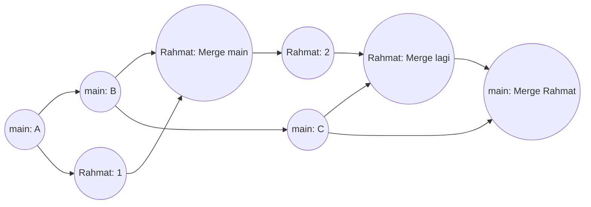

# 🌿 Panduan Kolaborasi Git Tim Quran App: Strategi `merge --no-ff` & `rebase`

> **Standar Operasional Prosedur (SOP) Tim Frontend**  
> **Topik**: *Feature Branch Workflow* dengan *Semi-Linear History*  
> **Target**: Memastikan riwayat kode proyek Quran App tetap rapi, stabil di *Production*, dan meminimalisir konflik (*conflict*) antar-developer selama masa pengembangan (M0 - M5).

---

## 🎯 1. Konsep Dasar: Mengapa Pola Ini Wajib Dipakai?

Dalam pengembangan aplikasi skala industri, pola kerja ini disebut **Feature Branch Workflow dengan Semi-Linear History**. Aturan emas di proyek ini sangat sederhana:

1. **Branch `main` adalah Suci (*Production-Ready*)**:
   * Kode yang ada di `main` adalah kode yang **100% stabil, dapat di-build tanpa error**, dan menjadi acuan rilis aplikasi.
   * **DILARANG KERAS** melakukan coding atau *commit* langsung di branch `main`.
2. **Setiap Pekerjaan Berada di Branch Masing-Masing (*Feature Branch*)**:
   * Setiap developer membuat branch sendiri berdasarkan fitur/tugas yang sedang dikerjakan (contoh: `feat/player-ui`, `feat/katalog-offline`, `fix/sorotan-ayat`).
3. **Lead Frontend Menggabungkan ke `main` dengan `merge --no-ff`**:
   * Ketika satu fitur selesai, Lead Frontend (Sahl) menggabungkannya ke `main` menggunakan flag `--no-ff` (*No Fast-Forward*).
   * **Tujuan `--no-ff`:** Git akan dipaksa membuat **1 titik simpul khusus (*Merge Commit*)**. Jika suatu saat fitur tersebut menyebabkan aplikasi *crash* (misal: *memory leak* di pemutar audio), Sahl cukup membatalkan (*revert*) 1 titik simpul tersebut tanpa merusak fitur milik developer lain.
4. **Developer Wajib Melakukan `rebase` Terhadap `main` Terbaru**:
   * Begitu `main` diperbarui dengan fitur baru, developer lain (Rahmat) yang masih mengerjakan tugas di branch miliknya wajib menarik pembaruan `main` lalu melakukan **`git rebase origin/main`**.
   * **Tujuan `rebase`:** Memindahkan pondasi branch Rahmat ke atas kode `main` yang paling baru. Hasilnya, riwayat *commit* tetap lurus dan rapi, bukan *spaghetti history*.

---

## 📊 2. Visualisasi Perbedaan: Tanpa Aturan vs Standar Proyek

### ❌ Cara yang DILARANG (Asal `git pull` & `git merge` Bolak-Balik)
Jika developer tidak menggunakan `rebase`, riwayat Git akan kusut dan sulit dilacak saat terjadi kegagalan sistem (*bug*):



### ✅ Cara Standar Proyek (`rebase` untuk Rahmat + `merge --no-ff` untuk Sahl)
Pondasi setiap branch selalu berpijak pada `main` terbaru. Setiap fitur yang masuk ke `main` tercatat jelas sebagai satu kubah fitur yang terisolasi:

```mermaid
flowchart LR
    subgraphMAIN ["Branch main (Production)"]
        A((Commit Awal)) --> B((Merge Fitur Sahl<br>--no-ff))
        B --> C((Merge Fitur Rahmat<br>--no-ff))
    end

    subgraphSAHL ["Branch feat/audio-player (Sahl)"]
        A --> A1((Setup just_audio))
        A1 --> A2((Logika PlayerController))
        A2 --> B
    end

    subgraphRAHMAT ["Branch feat/katalog-ui (Rahmat - Setelah Rebase ke B)"]
        B -. "Rahmat melakukan<br>git rebase origin/main" .-> S1((UI Grid Katalog))
        S1 --> S2((Filter Pencarian))
        S2 --> C
    end

    style A fill:#1e293b,stroke:#475569,color:#fff
    style B fill:#15803d,stroke:#22c55e,stroke-width:2px,color:#fff
    style C fill:#15803d,stroke:#22c55e,stroke-width:2px,color:#fff
    style A1 fill:#0369a1,stroke:#38bdf8,color:#fff
    style A2 fill:#0369a1,stroke:#38bdf8,color:#fff
    style S1 fill:#7e22ce,stroke:#c084fc,color:#fff
    style S2 fill:#7e22ce,stroke:#c084fc,color:#fff
```

---

## 🎬 3. Simulasi Alur Kerja Quran App (Flutter)

Simulasi kerja tim:
* 👨‍💼 **Sahl (Lead Frontend / PM)**: Menjaga branch `main` dan fokus pada logika inti (M1 & M2).
* 👨‍💻 **Rahmat (Frontend Developer)**: Fokus pada *slicing* UI dan data *mock* (M3 & M4).

### Babak 1: Mulai dari `main` yang Sama
Di repository utama (`origin/main`) baru ada struktur folder dasar aplikasi Flutter.

**1. Sahl membuat branch fiturnya:**
```bash
git checkout main
git pull origin main
git checkout -b feat/audio-player
```
*(Sahl mulai mengonfigurasi `just_audio` dan `audio_service` untuk Quran App).*

**2. Di saat yang sama, Rahmat membuat branch fiturnya:**
```bash
git checkout main
git pull origin main
git checkout -b feat/katalog-ui
```
*(Rahmat mulai membuat komponen UI Kartu Katalog dan Grid View).*

### Babak 2: Sahl Selesai Lebih Dulu & Melakukan `merge --no-ff`
Fitur Audio Player dari Sahl sudah lolos uji. Sahl menggabungkannya ke `main`:

```bash
git checkout main
git pull origin main
git fetch origin
# Sahl melakukan merge dengan bendera khusus
git merge --no-ff origin/feat/audio-player -m "Merge branch 'feat/audio-player' into main"
git push origin main
```
Sahl menginfokan ke tim: *"Update PlayerController sudah masuk ke main. Rahmat, jangan lupa rebase branch lu sebelum lanjut kerja."*

### Babak 3: Rahmat Melakukan `rebase` (Wajib!)
Rahmat masih di branch `feat/katalog-ui`. Kodenya tertinggal karena belum memiliki *PlayerController* terbaru yang Sahl buat. Rahmat wajib memperbarui pondasi branch-nya:

```bash
# 1. Rahmat memastikan semua kerjanya di-commit
git add .
git commit -m "feat(katalog): membuat layout grid nasheed dan podcast"

# 2. Ambil update dari server
git fetch origin

# 3. Pindahkan pondasi branch Rahmat ke ujung main terbaru!
git rebase origin/main
```

Jika sebelumnya Rahmat sudah pernah *push* branch-nya ke server, ia harus melakukan *force push* dengan aman:
```bash
git push --force-with-lease origin feat/katalog-ui
```

### Babak 4: Menangani Konflik di Flutter (*Merge Conflict*)
Misal Sahl dan Rahmat tidak sengaja mengedit file *router* yang sama (`lib/core/router/app_router.dart`). Saat Rahmat mengetik `git rebase origin/main`, terminal akan menampilkan status *CONFLICT*.

**Langkah Rahmat:**
1. Buka file `app_router.dart` di VS Code.
2. Cari tanda konflik Git:
   ```dart
   <<<<<<< HEAD
       // Kode dari main (Sahl)
       GoRoute(path: '/player', builder: (context, state) => const FullscreenPlayer()),
   =======
       // Kode dari Rahmat
       GoRoute(path: '/katalog', builder: (context, state) => const KatalogScreen()),
   >>>>>>> 8f3a1b2 feat(katalog): membuat layout grid nasheed dan podcast
   ```
3. Rapikan kodenya (karena kedua *route* dibutuhkan, hapus tanda `<<<`, `===`, `>>>`):
   ```dart
       GoRoute(path: '/player', builder: (context, state) => const FullscreenPlayer()),
       GoRoute(path: '/katalog', builder: (context, state) => const KatalogScreen()),
   ```
4. Tandai selesai dan lanjutkan *rebase*:
   ```bash
   git add lib/core/router/app_router.dart
   git rebase --continue
   ```

---

## 🏷️ 4. Standar Penamaan Branch & Pesan Commit (Wajib)

### A. Aturan Penamaan Branch
Format: `<tipe>/<nama-fitur-dengan-tanda-hubung>` (huruf kecil semua):
* **`feat/...`** (Fitur baru: `feat/reader-mushaf`, `feat/offline-download`)
* **`fix/...`** (Perbaikan bug: `fix/teks-arab-terpotong`, `fix/audio-berhenti`)
* **`refactor/...`** (Merapikan kode tanpa mengubah fungsi: `refactor/sync-engine`)

### B. Aturan Pesan Commit (*Conventional Commits*)
Format: `<tipe>(<modul>): <penjelasan singkat>`

| Awalan | Arti & Kapan Dipakai | Contoh di Proyek Ini |
| :---: | :--- | :--- |
| **`feat`** | Menambah fitur/UI baru. | `feat(reader): menambahkan auto-scroll ke ayat aktif` |
| **`fix`** | Memperbaiki *bug*. | `fix(player): memperbaiki durasi audio yang bernilai null` |
| **`style`** | Ubahan UI kosmetik (margin, padding, warna). | `style(katalog): menyesuaikan padding grid kartu mengikuti token` |
| **`refactor`**| Mengubah struktur/logika Dart tanpa mengubah UI. | `refactor(quran): memisahkan isolate parsing surat panjang` |
| **`chore`** | Ubahan konfigurasi (`pubspec.yaml`, aset). | `chore(assets): menambahkan file mock data JSON` |
| **`test`** | Menambahkan *unit/widget test*. | `test(sync): menambah test kalibrasi waktu mode B` |

> ❌ **COMMIT YANG DILARANG KERAS:**
> `git commit -m "update code"`, `git commit -m "fix bug"`, `git commit -m "lanjut ngerjain UI"`.

---

## 🛡️ 5. Tiga Hukum Besi (*Golden Rules*)

| No | Hukum Besi | Penjelasan |
| :-: | :--- | :--- |
| **1** | **JANGAN PERNAH `rebase` branch `main`!** | Perintah `git rebase` **HANYA** boleh dijalankan ketika sedang berada di *feature branch* milikmu sendiri (misal rebase dari origin/main). |
| **2** | **Wajib pakai `--force-with-lease`** | Setelah rebase, riwayat lokalmu berubah. Gunakan `--force-with-lease` (jangan `--force` mentah) saat *push* agar Git mengecek apakah ada kode lain di server yang tidak sengaja tertimpa. |
| **3** | **Area Kerja Harus Bersih Sebelum Rebase** | Pastikan `git status` bersih (semua sudah di-*commit* atau di-*stash*) sebelum mengetik perintah `git rebase`. |

---

## 📋 6. Lembar Contekan Cepat (*Cheat Sheet*)

### 👨‍💻 A. Untuk Frontend Developer (Rahmat)
```bash
# 1. Mulai fitur baru dari kondisi main terkini
git checkout main
git pull origin main
git checkout -b feat/nama-fitur

# 2. Simpan progres harian
git add .
git commit -m "feat(modul): deskripsi yang jelas"
git push -u origin feat/nama-fitur

# 3. WAJIB SEBELUM MENYERAHKAN KODE (Tarik update dari Sahl)
git fetch origin
git rebase origin/main
# (Bila ada konflik: perbaiki file -> git add <file> -> git rebase --continue)
git push --force-with-lease origin feat/nama-fitur
```

### 👨‍💼 B. Untuk Lead Frontend (Sahl)
```bash
# Menggabungkan branch Rahmat yang sudah bersih ke main
git checkout main
git pull origin main
git fetch origin

# Gabungkan dengan bendera pelindung riwayat
git merge --no-ff origin/feat/nama-fitur -m "Merge branch 'feat/nama-fitur' into main"

# Tayangkan / Build Rilis
git push origin main

# (Darurat) Jika fitur Rahmat menyebabkan crash, batalkan merge tersebut:
git revert -m 1 <hash-commit-merge>
```